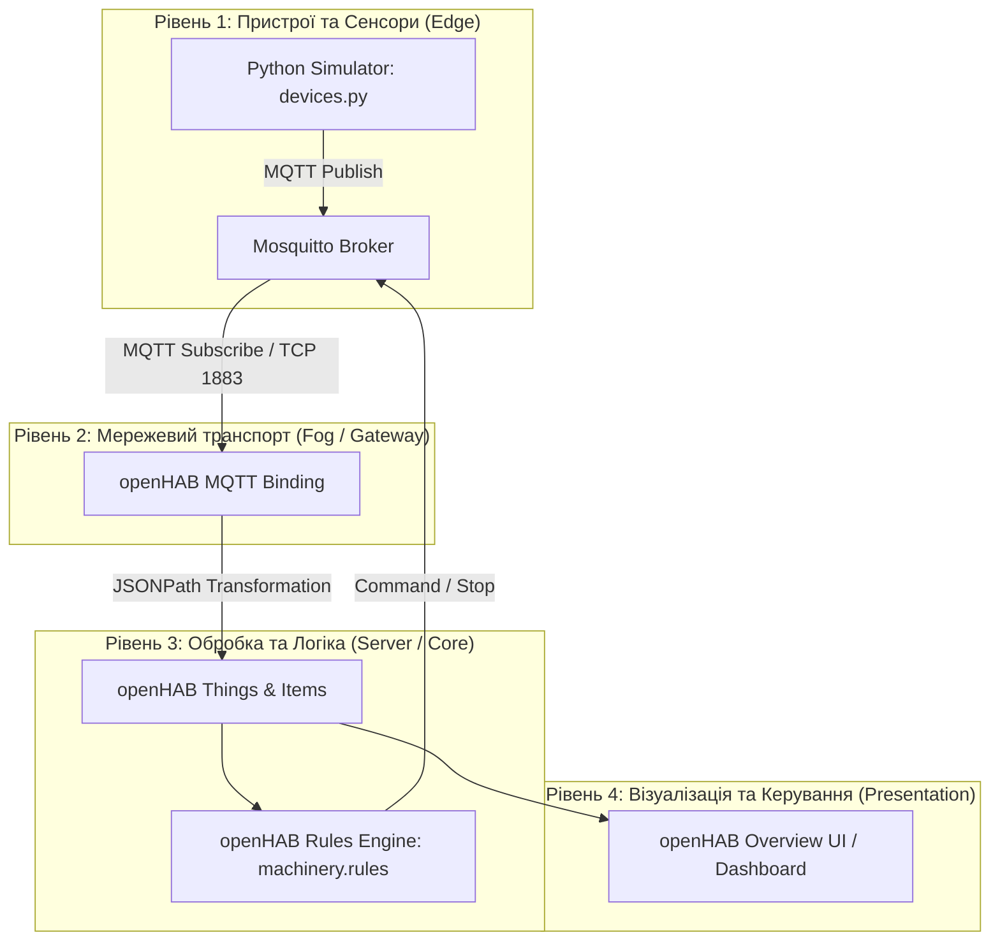

# IIoT Machinery Monitoring (Варіант 4)

🔗 **Демонстраційне відео роботи системи:** [Посилання на YouTube / Google Drive (додати перед здачею)](...)

---

## 1. Загальний опис системи та варіанта
Цей проєкт реалізує систему моніторингу промислового обладнання (**IIoT — Industrial Internet of Things**) за **Варіантом 4**. 
Система призначена для збору телеметричних даних з віртуального промислового станка (`Machine 01`), передачі їх через легковісний брокер повідомлень за протоколом MQTT, обробки на сервери автоматизації та відображення в реальному часі на інтерактивному дашборді з реалізацією правил аварійної зупинки.

### Технологічний стек:
* **Оркестрація:** Docker Compose (Mosquitto + openHAB)
* **Брокер повідомлень:** Eclipse Mosquitto
* **Сервер автоматизації та UI:** openHAB (з файловою конфігурацією `.things`, `.items`, `.rules`)
* **Симулятор обладнання:** Python (`paho-mqtt`, `json`)

---

## 2. Архітектура системи (Mermaid) та таблиця пристроїв

Архітектура побудована за чотирьохрівневою схемою IIoT:

| Назва пристрою | Тип сутності | MQTT Топік | Параметри / Канали |
| :--- | :--- | :--- | :--- |
| **Machine 01** | Generic MQTT Thing | `iiotequip/machinery/machine_01/telemetry` | Vibration, Temperature, Current, Parts, Status |
| **Machine 01 Status** | State Topic | `iiotequip/machinery/machine_01/status` | Device Status (`online` / `offline`) |
| **Machine 01 Command**| Command Topic | `iiotequip/machinery/machine_01/set` | Remote Control / Stop command |

3. Обґрунтування місця обробки даних (Edge / Fog / Cloud)
У даному проєкті реалізовано гібридну архітектуру на рівні Edge (Периферія) та Fog (Туманний обчислювальний шар):

Edge-рівень: Python-симулятор виконує первинну генерацію та структурування сирих даних у формат JSON на стороні віртуального контролера.

Fog-рівень (Локальний сервер / Docker): Брокер Mosquitto та сервер openHAB розгорнуті локально в контейнерах. Обробка телеметрії, парсинг через JSONPath та виконання тригерів (rules) відбуваються локально без звернення до хмарних сервісів. Це забезпечує мінімальні затримки (латентність), стійкість до втрати інтернет-з'єднання та високий рівень безпеки промислових даних.

4. Обґрунтування вибору протоколу MQTT
Для Варіанту 4 було обрано MQTT порівняно з іншими протоколами з таких причин:
На відміну від HTTP (який працює за запит-відповідь і створює зайве навантаження через постійне опитування) або CoAP, MQTT використовує легковагову модель видачі-підписки (Publish-Subscribe), має мінімальний розмір заголовка пакета (від 2 байт) і підтримує постійне з'єднання по TCP. Порівняно з бездротовими мережевими протоколами на кшталт Zigbee чи LoRaWAN, які вимагають специфічного радіообладнання (шлюзів, трансиверів), MQTT ідеально підходить для IP-орієнтованих віртуальних симуляторів та контейнеризованих середовищ, забезпечуючи надійну доставку повідомлень у реальному часі.

| Topic | Напрямок | Опис payload |
| :--- | :--- | :--- |
| `iiotequip/machinery/machine_01/telemetry` | Publisher $\to$ Broker | JSON-об'єкт з показниками (`value`, `temperature`, `current`, `parts`, `status`) |
| `iiotequip/machinery/machine_01/status` | Publisher $\to$ Broker | Статус життєздатності пристрою (`online` / `offline`) |
| `iiotequip/machinery/machine_01/set` | Broker $\to$ Publisher | Команди керування станком (наприклад, зупинка) |
